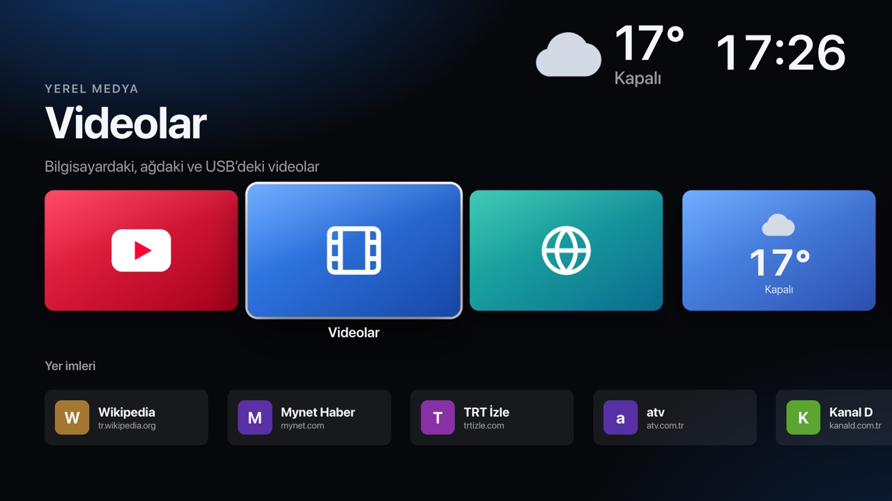
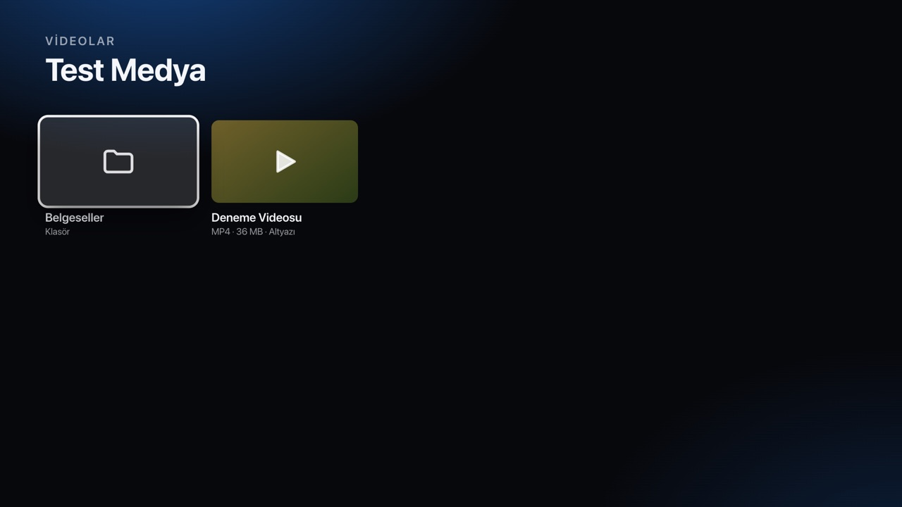
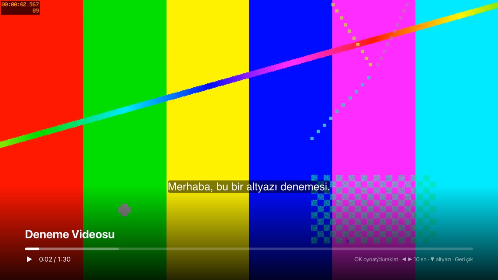
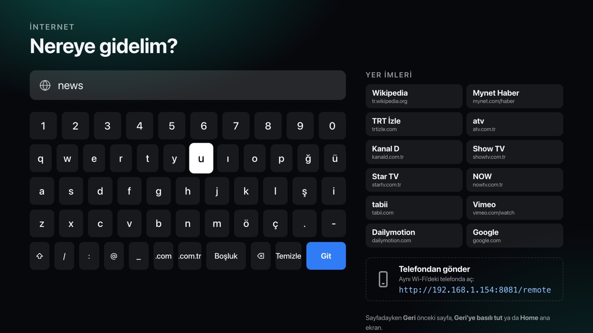
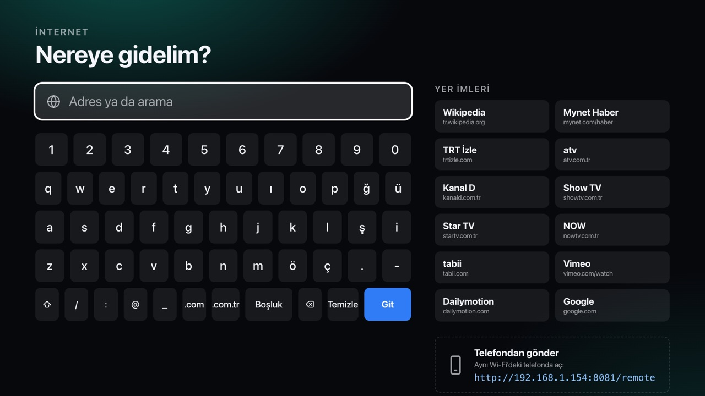
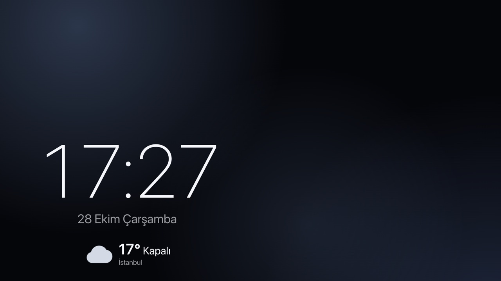

# Pi TV Launcher

**An Apple TV–style, remote-controlled home screen for a Raspberry Pi plugged into your TV.**

Big focusable cards, arrow-key / TV-remote navigation, YouTube's TV interface, a local video
player with subtitles, a 10-foot web browser with an on-screen keyboard, live weather, and a
"send a link from your phone" page. It is a plain web app (HTML/CSS/vanilla JS, no build step)
that runs full-screen in Chromium's kiosk mode, so the exact same code runs in a desktop browser
during development and on the Pi in production.



| Local videos | Player with subtitles |
|---|---|
|  |  |
| **Web browser + on-screen keyboard** | **Weather** |
|  |  |
| **Screensaver** | |
|  | |

> The UI text is currently in Turkish. All strings live in `web/js/screens/*.js`, so translating is straightforward.

## Features

- **10-foot UI**: large horizontally scrolling cards, a "top shelf" hero for the focused item, and a strong focus ring. Layout is designed for 1920×1080 and scales to any window size.
- **Spatial navigation**: arrow keys / D-pad + OK + Back. Rows remember their last focused item, like tvOS. Implemented in ~100 lines (`web/js/nav.js`), inspired by [Norigin Spatial Navigation](https://github.com/NoriginMedia/norigin-spatial-navigation) and js-spatial-navigation.
- **YouTube**: opens the real TV interface (`youtube.com/tv`) via a small kiosk extension that sends a TV user agent *only* for that page. If YouTube rejects it, the launcher detects the redirect and falls back to regular youtube.com. Single video links play in an embedded, remote-controllable player (IFrame API).
- **Local videos**: browse folders on the Pi, USB drives, or a NAS mount. Streaming supports HTTP Range for instant seeking. The player resumes where you left off, and `.srt`/`.vtt` subtitles next to the video are loaded automatically (legacy Turkish `cp1254` encoding is auto-detected).
- **Web browser**: address bar, bookmarks, and an on-screen keyboard. Pages open full-screen. On any site, **Back** goes to the previous page and **holding Back** or pressing **Home** returns to the launcher. Chromium's `--enable-spatial-navigation` makes ordinary websites usable with arrow keys.
- **Phone remote**: open `http://<pi-ip>:8080/remote` on your phone to send a URL or YouTube link to the TV, or use the virtual D-pad. This works even when the TV is on another site.
- **Weather & clock**: live cards plus a full weather screen (now, hourly, 7-day) powered by [Open-Meteo](https://open-meteo.com) (no API key). Weather icons are animated.
- **Screensaver**: clock, date and weather over a slowly drifting background. Content moves every minute to avoid burn-in. It never starts during playback.

## Hardware requirements

| Component | Minimum | Recommended |
|---|---|---|
| Board | Raspberry Pi 4 Model B, 2 GB | Raspberry Pi 4 (4 GB) or **Raspberry Pi 5 (4/8 GB)** |
| Storage | 16 GB microSD (A1) | 32 GB+ microSD (A2) or a USB 3 SSD |
| Power | Official PSU: 5 V 3 A USB-C (Pi 4) | Official 27 W 5 V 5 A USB-C PSU (Pi 5) |
| Video cable | micro-HDMI → HDMI | Same; use the port next to the USB-C power port (HDMI 0) |
| TV | Any 1080p TV with HDMI | TV with **HDMI-CEC** enabled (Samsung *Anynet+*, LG *SimpLink*, Sony *Bravia Sync*, Philips *EasyLink*…) so the TV's own remote controls the launcher |
| Network | Wi-Fi | Wired Ethernet or 5 GHz Wi-Fi for HD streaming |
| Cooling | Passive heatsink (Pi 4) | Official Active Cooler (Pi 5) for sustained video playback |
| Optional | — | USB keyboard for first setup; USB drive or NAS share for your media |

**Media and performance notes**

- The target is 1080p output. 4K playback is not a goal on this hardware.
- H.264, VP9 and AV1 video with AAC/Opus/MP3 audio play in Chromium. **HEVC/H.265, AC3/E-AC3 and DTS do not**, so re-encode those files (for example with `ffmpeg -c:v libx264 -c:a aac`).
- DRM services (Netflix, Disney+, Prime Video…) are **out of scope**. The Pi has no Widevine L1 or device certification, so they either refuse to play or cap at SD.

## Quick start (development on macOS / Linux / Windows)

Requirements: Python 3.9+ and a Chromium-based browser.

```bash
git clone https://github.com/Toygarmetu/pi-tv-launcher.git
cd pi-tv-launcher

python3 server/server.py          # → http://localhost:8080
```

Open http://localhost:8080 in any browser and use the arrow keys, Enter and Esc.

For the full kiosk experience (YouTube TV, Back/Home on other sites, phone links while browsing),
the helper extension in `extension/` must be loaded. Google Chrome 137+ ignores `--load-extension`,
so on macOS the helper script can fetch a disposable Chrome for Testing into the project folder:

```bash
./scripts/run-mac.sh --setup      # once: downloads Chrome for Testing into .browser/
./scripts/run-mac.sh              # server + 1280×720 app window
KIOSK=1 ./scripts/run-mac.sh      # full-screen kiosk (quit with ⌘Q)
```

Nothing is installed system-wide: `.browser/` and `.profile/` live inside the repo and are git-ignored.

### Keys

| TV remote | Keyboard | Action |
|---|---|---|
| ◀ ▲ ▶ ▼ | Arrow keys | Move focus · seek ±10 s in the player · ▼ toggles subtitles |
| OK | Enter | Select · play/pause |
| Back | Esc / Backspace | Back; previous page on websites |
| Back (hold ~1 s) | Hold Esc | Return to the launcher from anywhere |
| Home | Home / F10 | Return to the launcher |

## Configuration

Everything lives in `config.json`. Put machine-specific overrides (your location, media paths) in
`config.local.json`, which is git-ignored and deep-merged on top:

```json
{
  "mediaDirs": [ { "name": "Movies", "path": "/mnt/nas/movies" }, { "name": "USB", "path": "/media" } ],
  "weather": { "name": "Berlin", "latitude": 52.52, "longitude": 13.40 },
  "screensaver": { "idleMinutes": 5 },
  "youtube": { "mode": "auto" },
  "bookmarks": [ { "title": "Wikipedia", "url": "https://wikipedia.org" } ]
}
```

- `youtube.mode`: `auto` uses TV mode when the extension is present and web mode otherwise. You can force either one with `tv` or `web`.
- `screensaver.idleMinutes`: `0` disables the screensaver. Append `?idle=5` to the URL to test it after 5 seconds.
- Config changes apply on page reload; no server restart is needed.

## Architecture

```
config.json              settings (+ optional config.local.json)
server/server.py         Python standard library only: static files, media listing,
                         Range streaming, SRT→WebVTT, Server-Sent Events for the phone remote
web/
  index.html, css/       the launcher (ES modules, no bundler)
  js/nav.js              spatial navigation
  js/keys.js             key → action mapping (CEC remote keys land here too)
  js/screens/*.js        home, videos, player, youtube, browser, weather, clock
  js/screensaver.js
  remote.html            phone remote page
extension/               Manifest V3 kiosk helper
  rules/youtube-tv.json    TV user agent for youtube.com/tv (declarativeNetRequest)
  youtube-tv-ua.js         matching navigator.userAgent override (MAIN world)
  keys.js                  Back / Home handling on every website
  background.js            phone events while on other sites, YouTube TV fallback detection
  offscreen.js             keeps the SSE connection alive (MV3 service workers sleep)
scripts/run-mac.sh       development launcher
```

**Why the extension?** Most sites forbid being embedded in an iframe (`X-Frame-Options` / CSP), so web
pages and YouTube TV open as real top-level pages. Once you leave the launcher, its JavaScript is gone
and kiosk mode has no browser UI. The extension restores the Back/Home keys everywhere and keeps the phone
remote working. The launcher itself still works without it in any browser.

## Raspberry Pi deployment

🚧 **Work in progress.** So far the launcher has been developed and tested on macOS (Chrome and Chrome for
Testing). The planned Pi setup:

1. Raspberry Pi OS (Bookworm or newer, labwc/Wayland) with Chromium.
2. A systemd user service for `server/server.py`, with Chromium started from the labwc autostart in
   `--kiosk` mode with the extension loaded.
3. Screen blanking disabled and the cursor hidden.
4. HDMI-CEC: map the TV remote's keys (arrows, OK, Back, Home, play/pause) to keyboard events so the TV's own remote drives the UI.
5. Auto-mounted USB drives under `/media`, plus an optional NAS (SMB/NFS) mount.

## Known limitations

- The YouTube TV user agent (`extension/rules/youtube-tv.json`, `extension/youtube-tv-ua.js`) worked as of October 2026. YouTube may change its detection, and the launcher then falls back to the regular site automatically.
- The local server binds to `0.0.0.0` so your phone can reach it. It has no authentication, so run it only on a trusted home network.
